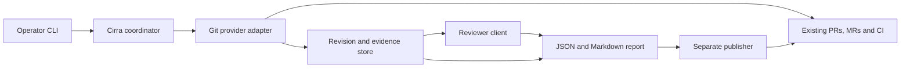

# Cirra coordination layer implementation plan

Date: 2026-10-15. Status: implementation available across milestones 1–5;
credential-dependent live demonstrations remain open. The
[automation guide](../automation-workflow.md) describes the implemented CLI and
[reviewer evaluation](../../eval/README.md) records two frozen real-agent runs.
The [review record](2026-10-15-planning-review.md) explains the original decisions.

## Implementation status

| Planned outcome | Current state |
| --- | --- |
| Local foundation and manual session handoff | Implemented and previously landed. |
| Automatic reviewer | Claude subscription dispatch with tools disabled, bounded execution, durable reuse and transport attribution. |
| Trusted checkout provenance | Signed independent-witness statements and exact check/attempt binding implemented. A live independent witness is not provisioned; native hosted CI remains association-only. |
| Review-quality evaluation | Ten frozen labelled cases, two runs; 6/6 defects and 0/4 clean-case findings each. Human usefulness adjudication remains open. |
| GitHub advisory publication | Scoped App credentials verified. PR #5 demonstrates a neutral check, repeat publication, explicit re-review, lost-acknowledgement recovery and refusal of an older attempt. Revision-change cases are in progress. |
| GitLab portability | Version-pinned MR collection, pipeline job normalization and maintained advisory notes implemented. Sandbox token cannot read repository content; no open test MR or separate note publisher is configured. |
| Forgejo | Explicit HTTPS-instance read adapter implemented; public Codeberg capture exercised. Missing status creator identities remain unverified. Publication is not enabled. |
| Event triggers | Authenticated saved webhook intake, replay detection and current-state capture implemented. Existing webhook infrastructure supplies deliveries; no resident scheduler. |
| Release coordination | Evidence-bound requests, definition-verified CI, merged/protected-ref checks, separate Actions-only tokens and native dispatch/reconciliation implemented. No live release dispatched. |
| Controlled live mutation cases | Local recovery/adapter cases cover them; new-head/base-only/fork publication demonstrations still require the scoped live setup. |

The milestone sections below retain their acceptance requirements. Implementation
availability does not imply that credential-dependent acceptance is complete.

## Governing decision

The latest direction in the founding discussion governs this plan:

> The important distinction is that we're not trying to rebuild GitHub or GitLab. We're building an independent layer that coordinates their capabilities.

Cirra will connect existing Git providers, conventional CI evidence, and AI
reviewers. Its value is a repeatable review process, evidence tied to the
revision actually examined, and comparable results across providers and models.
The [original concept](../original-concept.md) remains the historical record;
hosting comparisons and migration experiments are secondary to this goal.

## First useful workflow

An operator selects one GitHub pull request. Cirra captures its revision and
diff, collects the repository's existing CI results, obtains one AI review,
and produces a report showing checks, findings, coverage, and failures
separately. An explicit publish command puts that report in one advisory native
check on the examined commit. A retry updates the same publication where its
identity can be recovered.

Primary workflow commands:

```text
cirra review --provider github --repo mdn87/cirra --change <pr-number>
cirra show --run <run-id>
cirra publish --run <run-id>
cirra publish --run <run-id> --reconcile
cirra publish --run <run-id> --retry-uncertain
```

`review` writes local JSON and Markdown and performs no provider writes.
`publish` refreshes CI evidence without another model call, revalidates the
snapshot, and uses separate publishing credentials. A head or base mismatch
refuses publication and directs the operator to run `review` again.
The first end-to-end demonstration uses a designated test PR with existing CI,
a repeat invocation, and a new head commit. Cirra's own repository can supply
this PR once implementation adds its normal CI workflow.

## Decisions and ownership

| Decision | Choice and reason |
| --- | --- |
| Initial CI integration | Observe existing CI. This proves useful coordination without owning job execution. Triggering existing workflows is a later capability. |
| Provider order | GitHub first, GitLab second. GitLab deliberately tests a different merge-request and pipeline model. Forgejo remains a later self-hosting option. |
| Initial interface | A Python CLI with bounded polling during an invocation. No resident service is needed for the first workflow. |
| Persistence | Standard-library SQLite for run checkpoints, work claims, and publication receipts; JSON and Markdown for exported reports. |
| Configuration | Small, schema-validated, operator-local YAML for expected checks, provider endpoints, reviewer settings, and limits. Record its source path and content digest; repository-sourced configuration is deferred. |
| Review backend | Use an existing agent session first: export a frozen, bounded packet and import structured findings with session attribution. Automatic dispatch and a direct model API client are optional later adapters. Tests also use a deterministic fake reviewer. |
| Publication | One GitHub check with a summary. Defer PR comments and inline review threads until they provide demonstrated value. |
| Merge authority | Providers retain permissions and merge rules; maintainers judge findings and merge. Cirra's initial output is advisory. |

Providers continue to own repositories, PRs/MRs, issues, native workflows,
runner scheduling, permissions, and merge enforcement. Existing runners execute
conventional checks. Cirra owns input collection, normalization, review
invocation, evidence policy, reports, and evaluation. The reviewer proposes
findings; it cannot publish, merge, or change policy.

Autowork and Roundtable helped develop this plan. They remain optional development
and reviewer-dispatch tools. The local session handoff accepts their output once
it conforms to Cirra's response contract, without requiring either at runtime.

## Small architecture



Start with concrete modules for the CLI, domain records, policy, SQLite store,
GitHub adapter, reviewer client, and report renderer. Separate provider reading
from publishing authority even when they share low-level HTTP helpers. Use
small Python interfaces; introduce a registry or plugin framework only after
real integrations demonstrate the need.

| Record | Minimum information |
| --- | --- |
| Change snapshot | Provider kind and instance, stable repository ID, change ID, head SHA, actual diff-base SHA, target SHA where relevant, diff digest and coverage. |
| Check evidence | Native run/check and attempt IDs, source identity, raw and normalized state, associated SHA, tested SHA when known, revision relationship, trigger, source URL and observation time. |
| Review attempt | Snapshot and input digests, trusted policy/config/prompt digests, model endpoint and identity/version when available, attempt number, outcome, duration, usage and cost or an explicit unknown value. |
| Finding | Validated path, old path for renames, old/new diff side and line range, severity, rationale/evidence, and reviewer attribution. Unlocated observations are separate notes. |
| Report and publication | CI assessment, review outcome, findings, coverage, execution errors, snapshot, report digest, publication intent, remote object ID and acknowledgement state. |

The adapter owns pagination, provider authentication, status mapping, retries,
and proof of revision relationships. Provider-specific capabilities remain
explicit: native check runs, commit statuses, annotations, workflow dispatch,
and approval semantics are not interchangeable.

## Revision and failure rules

1. **Pin inputs.** A head SHA alone is insufficient. Include comparison base,
   target context, diff digest, and trusted configuration in analysis identity.
   For GitHub, capture target/head SHAs, compare the pinned commits, record the
   returned merge base, then re-read PR metadata. Retry a changed snapshot.
   Preserve comparison limits and omitted patches as coverage gaps.
2. **Reuse deliberately.** Identical review inputs reuse completed analysis and
   refresh CI evidence. An explicit re-review creates a new attempt. Serialize
   work for the same change using one shared SQLite store. Claims carry an
   owner, heartbeat/expiry and fencing generation; expired claims are recovered
   transactionally, and superseded owners cannot checkpoint or publish. Persist
   model responses before completing the step. A call whose outcome was lost
   requires an explicit re-review rather than an automatic second charge.
3. **Establish what CI tested.** A synthetic merge commit keeps its actual SHA.
   Classify evidence as `head_exact`, `merge_exact`, `associated_only`, or
   `unrelated`. Exact classes require trusted provenance of the checkout SHA
   and, for merges, its parents. A trigger event or check association alone is
   insufficient. Keep native success visible for `associated_only`, but do not
   count it as verified evidence. A base-only change invalidates an old merge
   relationship until new matching provenance arrives.
4. **Require explicit evidence.** Trusted policy identifies expected check
   sources and accepted outcomes. Missing, pending, skipped, cancelled,
   inaccessible, unknown, and failed are distinct. An intentionally empty
   expected-check set is reported as review-only. Exclude Cirra's own output;
   allowlist check-run app IDs plus names, or status creator IDs plus contexts.
   An unlisted identity cannot satisfy policy through a matching display name.
5. **Finish honestly.** Bounded deadlines produce an incomplete report when
   evidence or review is unavailable. Pagination failure, truncated input,
   malformed findings, and reviewer timeout never become a clean review with
   zero findings. Valid zero-finding reviews remain possible.
6. **Handle supersession.** Re-fetch current head/base before publishing. Old
   attempts cannot overwrite a newer report, including when only the base or
   configuration changes. Publish the head, diff-base, target, analysis digest,
   evidence observation time and monotonic publication generation. A push can
   still occur between validation and the API write, so every remote result is
   attached to and labelled with its exact examined revision; do not claim
   atomicity with a concurrent push.
7. **Recover publication carefully.** Persist intent before the API call and
   retain the native object ID. The GitHub publication slot is
   `(instance, repository_id, change_id, head_sha, publisher_app_id, report_kind)`.
   Its digest is a stable `external_id`; the check is named `cirra/review`, and
   its summary identifies the PR. Re-review and base-only changes update the
   same slot with a newer generation; a new head gets a new slot. This avoids
   conflating PRs sharing a commit, though GitHub displays checks at commit scope.
   Before create, find the owned object by exact SHA, app, name and slot marker.
   After a lost acknowledgement, repeat bounded read-only reconciliation;
   empty or multiple matches remain uncertain and never cause blind creation.
   `--reconcile` adopts a unique verified object. After unsuccessful reconciliation
   and manual inspection, `--retry-uncertain` explicitly permits one new attempt
   and records the operator's acceptance of residual duplicate risk. Multiple
   matches require selecting the verified canonical object before updates.
   Local receipts preserve crash history; they do not guarantee exactly-once
   remote delivery. Multiple independent Cirra stores publishing to one slot
   are outside the single-operator prototype contract.

Later webhooks are hints to fetch current state, not authority to replay stale
payloads. Read-only retries may use bounded backoff; authentication failures
need an actionable error. A publish-only retry must not purchase another AI
review.

## Authority and data boundaries

Treat titles, descriptions, filenames, diffs, CI metadata, and model output as
untrusted data. Review input is a bounded snapshot; Cirra does not check out,
import, install, or execute PR code. An automatic reviewer adapter must enforce
no shell/filesystem tools, provider credentials, or choice of publication
destination, and handle transport authentication outside model-visible content.
The implemented manual session handoff requests these restrictions but cannot
enforce them in an existing session. Its reports explicitly leave tool isolation
unverified; session ID and model labels are operator-supplied. This limitation
must not be mistaken for completion of the automated isolation acceptance tests.

Reader and publisher credentials stay in their respective trusted components.
Public collection can use anonymous GitHub reads. For authenticated collection,
provision a GitHub App for the selected test repository and mint a read-only
installation token for collection: Metadata, Contents, Pull requests, Checks,
Actions, and Commit statuses read as required by enabled endpoints. The separate
publisher token has Checks write and Metadata read; it consumes the validated
report and slot from the collector. Neither component has merge or
repository-content write authority. Never load PR-modified policy or endpoint
settings. Validate finding paths and lines
against the captured diff side, cap output, and render links and mentions safely.
Operator configuration must allowlist repositories and model endpoints approved
to receive their review data; private repository submission requires an explicit
data-handling choice. Keep credentials and excluded content out of model inputs
and logs, and record any omission as a coverage limitation.

Fork and same-repository PR content receive the same untrusted-input treatment.
If a fork's evidence or publication cannot be safely attributed with the
selected permissions, return a local report describing the limitation. Do not
broaden credentials to make the demonstration pass. Code execution, Docker,
and self-hosted runners require a later execution-isolation design.

## Implementation milestones

### 1. Local executable foundation

Implemented: see [offline workflow and acceptance coverage](../offline-workflow.md).
The fixture adapter consumes normalized synthetic payloads; raw provider API
collection is now available for GitHub in milestone 2; GitLab remains in milestone 4.
Combined automatic review and native publication commands are implemented;
manual session policies continue to use collection, prepare and import.

Add package metadata, CLI commands, domain records, trusted configuration,
SQLite checkpoints, report rendering, and deterministic fake provider/reviewer
implementations. Use local Git fixtures and recorded payloads. Add Cirra's normal
test/lint CI workflow, including recorded checkout-revision metadata for the
controlled integration cases; this remains a native provider workflow.

Acceptance: a fixture produces a complete JSON/Markdown report without network
access. Replaying inputs ten times and making two concurrent invocations keeps
one logical analysis; explicit re-review creates a distinct attempt. Restart
after analysis preserves it. Kill a claim owner before and after a model call;
exercise takeover, stale-owner fencing and uncertain-call recovery. Missing
checks and unsupported diff content are visible. Native tests exercise behavior.

### 2. GitHub collection and one real reviewer

Implemented first: [session packet export and response import](../session-workflow.md).
The operator can use an existing authenticated agent session, with no new model
API key. Packets bind findings to a run, snapshot, policy, and prompt/schema;
duplicate imports reuse the durable response, explicit rereview supersedes the
previous attempt, and validation/report creation can resume after interruption.
This remains a manual handoff. The separate Claude CLI adapter now provides
automatic tool-free invocation using the existing subscription login.

Implemented next: [GitHub collection](../github-workflow.md) captures pinned
head/target/merge-base revisions, available comparison patches, and paginated
check runs and commit statuses. It retries moving snapshots, preserves coverage
gaps and collection errors, and reuses reviews when only CI observations change.
Native results retain association-only provenance unless supplied with a valid
independent-witness receipt; no hosted CI witness has yet been provisioned. Cirra PR #2 supplied a live capture of 13 files and four checks.

Resolve a real PR snapshot, collect existing conventional checks, and create a
local report through one configured reviewer. Add pagination, revision
relationship handling, bounded retries, time/token/spend limits, and attribution.
Runtime collection is read-only on GitHub. Its setup prerequisites are a
designated test repository with CI, a read-only credential for authenticated
reads (public anonymous reads need none), an approved agent session and repository
data scope, and configured limits for any automatic dispatcher. The manual adapter reports
session usage/cost as unknown; a direct API endpoint and key are optional later
choices. Complete provider setup before the live collection acceptance run.

Acceptance: compare evidence with three controlled PR cases, including a new
head and a base-only change. Test old successes followed by a failed rerun,
unrelated SHAs, unknown states, provider outages, and reviewer timeout. Change
the head between metadata and diff reads; expect snapshot retry. A base-only
change with old merge evidence must remain unverified/incomplete. Injection
fixtures and a forced-malicious fake reviewer cannot obtain canary publisher
secrets, select a destination, execute tools, or invent valid file locations.

Create ten labelled review cases: six defective changes and four clean ones.
Include removed-line findings, renames, coverage limits, and seeded defects
accompanied by instructions to suppress findings or claim approval. Freeze
matching rules before tuning: correct root cause, file, diff side and a
pre-labelled hunk/range, with human adjudication of usefulness. Retain one
defective and one clean case unseen during tuning. Run the frozen configuration
twice. The prototype target per run is at least five of six seeded defects found and no
more than one false finding across the four clean cases; the held-out defect
must be found in both runs. Report held-out results and injection-case detection
separately, plus spurious findings on defective cases, all misses, duplicates,
usefulness judgements, latency, usage and known/unknown cost. These
are a demonstration gate, not a production accuracy claim. Failing the target
keeps the reviewer experimental; do not relax the labels to claim success.

### 3. Advisory publication and the first complete workflow

Implement the separate publisher, persisted intents/receipts, and reconciliation
after uncertain writes. Publish a neutral, clearly advisory GitHub check
summary; it reports evidence and review coverage, not permission to merge.
Keep it out of required merge checks during the prototype.

Acceptance: one designated PR demonstrates collection, conventional checks,
one review, and a native report. Repeat the run and advance the head. Verify
no duplicate publication in the controlled cases and no old report overwrites
a newer one. Simulate crashes before sending and after remote success but
before local acknowledgement. An ambiguous result remains visibly uncertain.
Repeat, explicit re-review, and base-only change retain one remote object for
the slot; a new head creates one new object. Delay a B1 report until after B2
publication on the same head and reject B1. Simulate delayed read visibility
after a lost acknowledgement, then resolve the uncertain state through
`--reconcile`. Verify actual credential permissions and fork behavior before
enabling writes.

This is the first complete Cirra prototype. The earlier stages are useful local
tools, but do not by themselves satisfy the native-report demonstration.

### 4. GitLab portability proof

Implement a GitLab adapter against the same coordinator, report schema, and
reviewer. Retain GitLab pipeline/status identity and explicit capability
differences. Use recorded cases first, then an authorized real merge request
with its existing CI and one maintained MR note per change. Choose the note
surface to avoid creating or changing pipelines through commit-status writes;
its summary includes the snapshot and publication generation. Retain the same
ownership, reconciliation and stale-update protections as the GitHub publisher.
Use a principal verified unable to merge or modify code/protection, and render
model text so GitLab quick actions such as `/merge` cannot execute.

Acceptance: equivalent GitHub/GitLab fixtures yield equivalent domain outcomes
while retaining native links and raw results. The live GitLab case includes a
rerun and an incomplete-evidence case. Provider differences stay in adapters
and configuration; no workflow-YAML translation or repository mirroring is
required. In a test project with pipeline-dependent merge rules, verify that
posting the note changes neither the pipelines nor merge eligibility; include
malicious quick-action text in this test. Mocked normalization alone is not the
live integration proof.

### 5. Extend coordination from demonstrated needs

Choose the next extension from prototype evidence: authenticated event
ingestion, invoking an existing provider workflow, a Forgejo adapter, or model
comparisons on the same corpus. Release coordination can assemble evidence for
a release candidate and request an existing release workflow while its native
approval and deployment controls remain authoritative.

Defer a custom scheduler, universal workflow language, runner fleet, deployment
platform, repository migration, automatic merge, and dashboard. Add isolated
execution only when a concrete workflow requires running untrusted code.

## Provider evidence informing the plan

Official documentation was checked on 2026-10-15. The following facts constrain
the implementation; the product choices above are Cirra design decisions.

- GitHub exposes commit-bound check runs with summaries, IDs and external IDs.
  This supports the first report surface, but an external ID is not a promise
  of server-enforced uniqueness. [GitHub Checks API](https://docs.github.com/en/rest/checks/runs)
- GitHub can dispatch an existing workflow configured for `workflow_dispatch`,
  with separate Actions write permission. This supports a later integration
  without creating a Cirra workflow executor. [GitHub workflow API](https://docs.github.com/en/rest/actions/workflows#create-a-workflow-dispatch-event)
- GitLab external status publication can attach a job to a pipeline or create
  an external pipeline; multiple pipelines can make selection ambiguous.
  Preserve native pipeline identity and verify these effects in the second
  adapter. [GitLab commit status API](https://docs.gitlab.com/api/commits/#set-commit-pipeline-status)
- GitLab provides create/update operations for MR notes; its note API also
  documents quick actions, which the publisher must neutralize in untrusted
  text. [GitLab Notes API](https://docs.gitlab.com/api/notes/#merge-requests)
- GitHub supports comparisons using commit SHAs and documents limits on changed
  files and patch coverage. These constrain snapshot collection.
  [GitHub compare API](https://docs.github.com/en/rest/commits/commits#compare-two-commits)
- Forgejo documents differences from GitHub Actions. Cirra should make its
  evidence and review contracts portable while leaving native workflow syntax
  with each provider. [Forgejo Actions reference](https://forgejo.org/docs/latest/user/actions/reference/)
- GitHub documents the risks of privileged untrusted-code checkout and
  persistent self-hosted runners. Keeping the first reviewer data-only avoids
  requiring a new PR-code execution environment.
  [GitHub secure-use guidance](https://docs.github.com/en/actions/reference/security/secure-use)

The remaining work is live setup and acceptance: independent checkout evidence,
GitLab repository-read access/test MR/separate note publisher, the remaining
controlled publication cases and operator usefulness adjudication.
Automatic dispatch, both publishers, GitLab/Forgejo collection, evaluation,
authenticated event intake and native release requests are implemented.
No new model API credentials are required for subscription review.
